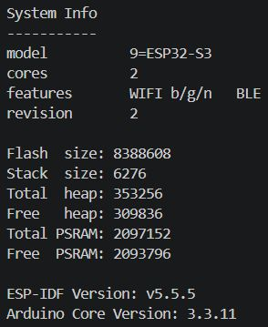
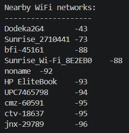
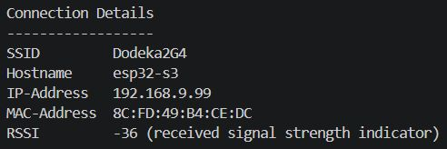

# Testing the addressable NeoPixel LED and  the Wi-Fi on an ESP32-S3 DevKit
Some development boards with the ESP32-S3 do not have a simple RGB LED, 
but rather an addressable WS2812-type NeoPixel. The easiest way to 
control these LEDs is to use one of the “Adafruit-NeoPixel” or “FastLED” 
libraries.

The program demonstrates how to generate the primary colors R, G, B, 
WHITE, and BLACK in a loop, or how to cycle through all possible color 
shades with values ranging from 0 to 65536 using the HSV color model. 

Simple printouts display system information, nearby Wi-Fi networks, and 
connection details. 

As soon as a Wi-Fi connection is established, the ESP32's internal 
real-time clock is synchronized with the local time of a time server. 
The time is then displayed on the monitor every 15 seconds in a 
selectable format.

These useful functions, which are frequently used in other projects, 
are included in the ToolkitCore and ToolkitWiFi libraries.

The LED control and the time display are executed in the main loop in a 
non-blocking manner without using `delay()`. To do this, the 
`WaitTimer` from the ToolkitCore is used, which is implemented as a C++ 
functor.

| System Info | Nearby Networks | Connection Details |
|:-----------:|:---------------:|:--:|
|  |  |  |
